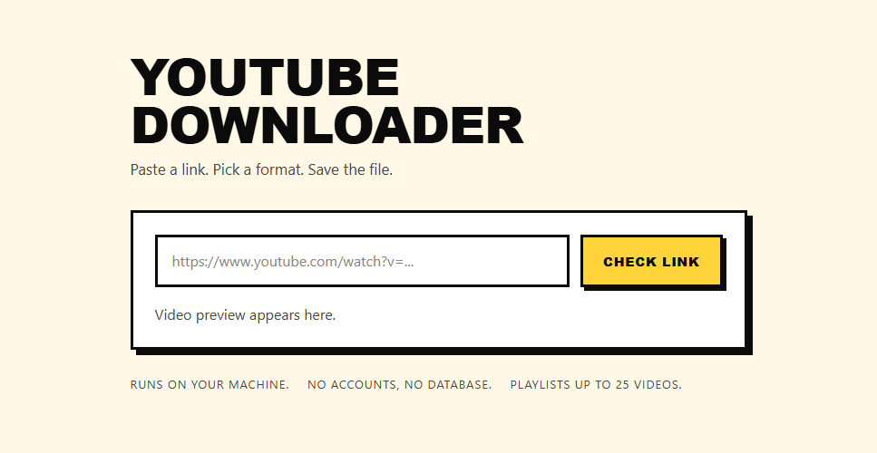
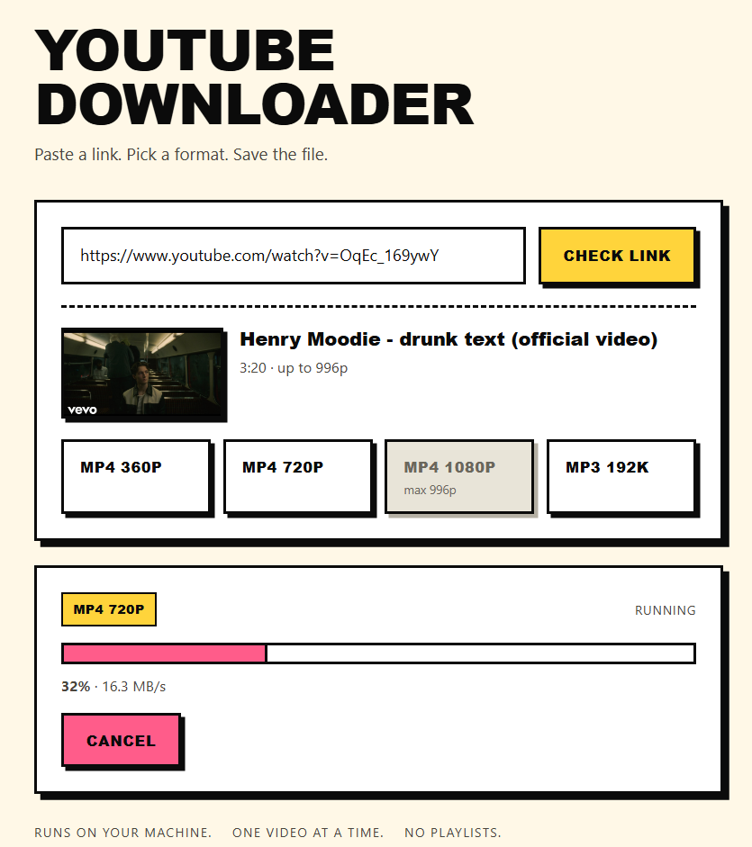
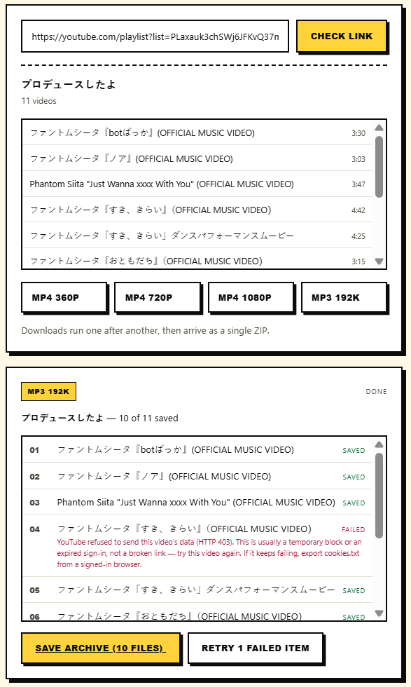

# YouTube Downloader

[](https://github.com/Arbi04/youtube-downloader/actions/workflows/ci.yml)

A local web app that turns a YouTube link — a video or a playlist — into files you can actually play: pick a resolution or an MP3 bitrate, watch the progress bar, save the result. A single local user, no accounts, no database.

**Status:** v1.0.0. Single videos, playlists up to 25 items, in-place retry of failed items, and one ZIP per playlist. Local-only by design.

<p align="center">
  
</p>

## Why local-only

This runs on `127.0.0.1` by design. A public, anonymous YouTube downloader gets its IP blocked by YouTube within days, pays for everyone else's bandwidth, and carries legal exposure that a portfolio project has no reason to take on. Running it locally keeps the interesting engineering — job handling, progress, format selection — without the parts that would get the domain taken down.

If you ever expose it, put it behind authentication and a rate limit first.

## Quickstart

Requirements:

- [uv](https://docs.astral.sh/uv/)
- `ffmpeg` on `PATH` — merges high-resolution video with audio and produces MP3s
- [Node.js](https://nodejs.org/) on `PATH` — solves YouTube's signature challenge. Deno, Bun, or QuickJS work too; the app uses whichever it finds first.

```bash
uv sync
uv run youtube-downloader
```

Open <http://127.0.0.1:8000>.

```bash
ffmpeg -version   # must print a version; the app reports a clear error if it is missing
node --version
```

The `yt-dlp[default]` extra is deliberate: it installs `yt-dlp-ejs`, the challenge
solver. Without a solver, YouTube hides every video stream on an account-backed
request and only thumbnails come back.

## How it works

1. Paste a URL. The server fetches metadata and renders a **Preview**: title, duration, thumbnail, and the presets this video actually supports.
2. Pick a preset. A **Job** starts in the background and the page polls its progress once a second.
3. When the job finishes, **Save file** hands you the file and the server deletes its temporary copy.

A playlist takes the same three steps, with one difference: the Preview lists the
items and starting it creates a **Batch** that downloads them one after another,
then hands you a single ZIP.

<p align="center">
  
</p>

A video download is two streams — video, then audio — so each gets its own half of
the bar. The number never goes backwards, and nothing reads as complete until the
job is.

| Preset | What you get |
| --- | --- |
| `mp4-360` / `mp4-720` / `mp4-1080` | H.264 + AAC in an MP4, merged with ffmpeg. H.264 is preferred so the file plays in Windows Media Player, QuickTime, phones, and editors; other codecs are used only when H.264 is unavailable. |
| `mp3-192` | MP3 at 192 kbps with ID3 tags and the thumbnail embedded as cover art. |

Presets taller than the source video stay visible but disabled, labelled `max 720p`, so you can see the limit instead of guessing why a button is missing.

## Playlists

Paste a `youtube.com/playlist?list=…` link and the Preview lists the items — title
and duration for each — with the same preset buttons.

- **One preset for the whole playlist.** Changing your mind means starting again; there is no per-item picker.
- **25 videos maximum**, taken from the front of the playlist. The Preview tells you when it truncated.
- **One item at a time.** A Batch takes one worker slot, so a 25-item playlist cannot starve the queue — or hammer YouTube with parallel requests that invite a bot check.
- **One ZIP at the end.** Files are named `01 - Title [id].mp4` inside a folder named after the playlist, so the original order survives extraction.
- **A broken video does not stop the batch.** Private, age-restricted, and geo-blocked items are reported in the list and left out of the archive. If every item fails, the Batch says so and offers no archive.
- **Retry only what failed, in place.** A finished Batch with failed items offers `Retry N failed items`. Only those items run again, inside the same Batch: the counter goes from `12 of 14 saved` to `14 of 14 saved`, the list keeps every item and its original number, and the single archive is rebuilt with all saved files. Saving the partial archive first is safe — its files stay, so Retry still works. While a retry runs, the bar tracks the item being retried and the summary keeps the playlist count.
- **Transient errors retry themselves.** A 403, an HTTP 429, or a dropped connection is tried up to three times — waiting 2 seconds, then 5 — before the item is marked failed. Items are also spaced two seconds apart so a long playlist does not look like abuse.
- **`watch?v=…&list=…` is still one video.** Only a `/playlist` link starts a Batch, so a link copied from a video page never silently turns into 25 downloads.

A 25-item video playlist can hold roughly 1 GB of temp files before the archive is
built, so expect the disk to fill and clear as it runs.

<p align="center">
  
</p>

A finished playlist keeps every item and its original number. One item failed here;
**Retry 1 failed item** downloads only that video and rebuilds the same archive.

## Configuration

All settings are environment variables, read once at startup.

| Variable | Default | Purpose |
| --- | --- | --- |
| `PORT` | `8000` | Port on `127.0.0.1`. |
| `TEMP_ROOT` | `<system temp>/youtube-downloader` | Where in-flight files live. |
| `YTDLP_COOKIES_FILE` | unset | Path to a Netscape-format `cookies.txt`. |
| `MAX_CONCURRENT_JOBS` | `2` | Downloads running at once. |
| `MAX_QUEUED_JOBS` | `5` | Jobs allowed to wait behind them. |
| `JOB_TIMEOUT_SECONDS` | `900` | Cooperative cutoff per job. |

## When YouTube says "Sign in to confirm you're not a bot"

Some videos — and eventually most requests from a datacenter IP — need cookies. yt-dlp reads them from a Netscape-format `cookies.txt`.

1. Log in to YouTube in your browser.
2. Install a cookie-export extension such as **Get cookies.txt LOCALLY** (Chrome, Edge, Firefox). It produces the Netscape format yt-dlp expects and keeps the export local.
3. Open `youtube.com`, click the extension, and export. Save the file as `cookies.txt` outside this repo.
4. Point the app at it and restart:

```powershell
$env:YTDLP_COOKIES_FILE = "C:\path\to\cookies.txt"
uv run youtube-downloader
```

On macOS/Linux the same variable works inline: `YTDLP_COOKIES_FILE=/path/to/cookies.txt uv run youtube-downloader`.

The app maps that failure to a message naming this variable, rather than showing a traceback. The same applies to age-restricted videos.

`cookies.txt` is a credential: it grants access to the account it came from. `.gitignore` excludes `cookies*.txt`, but keep the file outside the project anyway, and never paste it into an issue. Cookies expire after weeks or months — re-export when downloads start failing again.

### Cookies need a JavaScript runtime

Signing in changes which formats YouTube hands out: they arrive behind the
`n`-signature challenge, which only a JavaScript runtime can solve. If none is
installed, a signed-in request returns *fewer* formats than an anonymous one —
usually none at all — and the app reports "no downloadable format matched".
Install Node.js (or Deno) and restart; the app detects it automatically.

## Known limitations

- **No channels** — a channel URL is not a playlist. Playlists are capped at 25 videos, all with one preset.
- **No history and no database** — job state is in memory, so a restart drops whatever was in flight.
- **Files are temporary** — the server deletes its copy after the browser has the file, and sweeps leftovers older than two hours at startup. A Batch archive is deleted the same way, which means it is gone once you have downloaded it.
- **Not multi-user** — no auth, no per-user quotas.
- **YouTube moves constantly** — when downloads start failing after a YouTube change, upgrade the engine: `uv lock --upgrade-package yt-dlp && uv sync`.
- **Signed-in requests need a JS runtime** — see [Cookies need a JavaScript runtime](#cookies-need-a-javascript-runtime). This is a yt-dlp requirement, not a choice this app makes.

## Tests

```bash
uv run pytest -q
```

The suite is offline: `yt-dlp` is replaced by a fake behind the `Downloader` protocol, jobs run through a manual executor, and time is injected. No network, no sleeps. CI runs the same command on Linux and Windows for every push and pull request. What the tests *cannot* prove is that a real download works — that stays a manual smoke check, because it depends on YouTube.

## Architecture

```
routes/            HTMX endpoints: preview, job and batch lifecycle, file delivery
services/jobs.py   in-memory registry, batch runner, archive builder, queue, cancel, sweep
services/downloader.py   the only module that imports yt_dlp
services/youtube.py      URL allowlist, Preview, Preset, Batch items, format selectors
templates/         Jinja2 + HTMX fragments, no build step
static/            hand-written CSS, vendored htmx
```

Three decisions are worth knowing before reading the code:

- **Jobs run in-process.** No Redis, no Celery, no database — see [`docs/adr/0001-in-process-jobs.md`](docs/adr/0001-in-process-jobs.md). The consequence is that cancellation is cooperative: Python cannot kill a thread, so the worker checks a flag on each progress hook.
- **A Batch is one worker slot, not one Job per item** — see [`docs/adr/0002-batches.md`](docs/adr/0002-batches.md). Items run sequentially and produce a single archive.
- **`services/downloader.py` is the only yt-dlp import.** Everything else talks to the `Downloader` protocol. That seam is what keeps the suite offline and what would make swapping engines a local change.

Vocabulary lives in [`GLOSSARY.md`](GLOSSARY.md): **Preview**, **Preset**, **Job**, **Batch**, **Playlist**.

## License

MIT — see [`LICENSE`](LICENSE).

## Legal

For personal use with content you have the rights to. Downloading copyrighted material may violate YouTube's Terms of Service and the rights of the uploader. This project is not deployed as a public service, and you should not deploy it as one.
